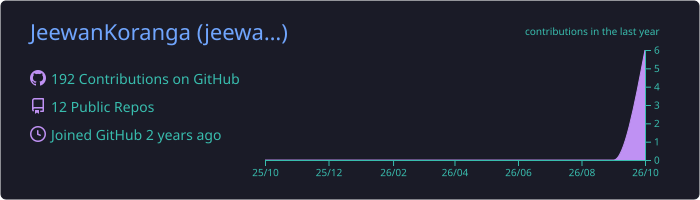
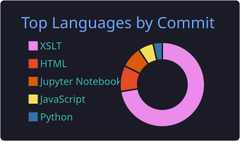
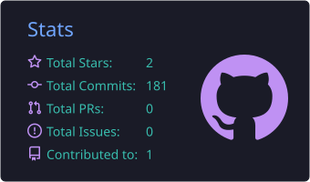
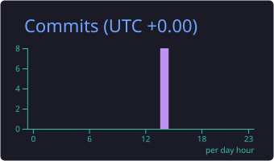

<!-- Header banner -->

<!-- Typing animation -->

  

## 👨‍💻 About Me
- 🎓 B.Tech CSE graduate from Graphic Era Hill University (CGPA 8.08)
- 🔭 Working on: **Deep learning projects in computer vision and explainable AI**
- 🌱 Learning: **Machine Learning, Deep Learning, SQL, AWS and Google Cloud, Tableau**
- 📄 Published researcher: **IEEE I3CEET 2024** and **Elsevier's Engineering Applications of Artificial Intelligence (2026)**
- 🎬 Also a video editor: **Adobe Premiere Pro and After Effects**
- 💬 Ask me about: **Python, Machine Learning, Data Processing, Excel, Video Editing**
- 📫 Reach me: jeewankoranga163@gmail.com

## 🛠️ Tech Stack

## 📊 GitHub Stats

  
  

  
  

## 🔥 Contribution Streak

  

<!-- Footer -->

